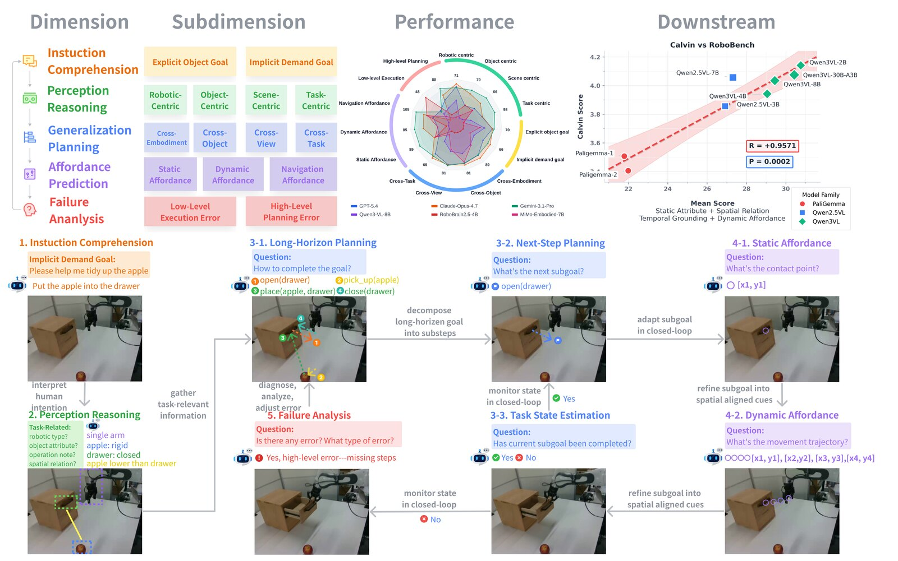

<h1 align="center">RoboBench</h1>

<p align="center">
  <strong>A Comprehensive Evaluation Benchmark for Multimodal Large Language Models as Embodied Brain</strong>
</p>

<p align="center">
  <a href="https://arxiv.org/abs/2510.17801"></a>
  <a href="https://robo-bench.github.io/"></a>
  <a href="https://huggingface.co/datasets/LeoFan01/RoboBench"></a>
  <a href="https://huggingface.co/datasets/lyl010221-pku/RoboBench-Results"></a>
  <a href="LICENSE"></a>
  
  <a href="https://eccv.ecva.net/virtual/2026/poster/4213"></a>
  <a href="https://www.youtube.com/watch?v=_W3FSK75IRQ"></a>
</p>

<p align="center"><a href="https://robo-bench.github.io/static/pdfs/robobench_eccv2026_poster.pdf">Poster PDF</a> · <a href="https://robo-bench.github.io/#leaderboard">Leaderboard</a> · <a href="#quick-start">Quick start</a></p>

## Overview

RoboBench evaluates how multimodal large language models understand instructions, interpret robot observations, plan actions, reason about affordances, and diagnose failures. The ECCV 2026 release covers **5 dimensions, 14 capability groups, 25 tasks, and 6,092 questions**. The official leaderboard includes **18 evaluated MLLMs** and separate human and text-only references.

<p align="center">
  
</p>

## News

- **2026.11** — [ACE-Brain-0.7](https://arxiv.org/abs/2611.26519) reports task decomposition, next-subtask prediction, and step completion results on 3,979 RoboBench questions.
- **2026.09** — Li Auto reports results for two [ME-VLM variants](https://arxiv.org/html/2609.24526v1#S6), also presented in the [ME-Brain-1.0](https://arxiv.org/html/2609.24271v1#S7) cognitive-core evaluation.
- **2026.09** — The ECCV 2026 poster is available as a [PDF](https://robo-bench.github.io/static/pdfs/robobench_eccv2026_poster.pdf) and on the [ECCV poster page](https://eccv.ecva.net/virtual/2026/poster/4213).
- **2026.07** — Tencent reports [HY-Embodied](https://github.com/Tencent-Hunyuan/HY-Embodied) results on RoboBench-MCQ and RoboBench-Planning.
- **2026.07** — RoboBench was accepted to ECCV 2026. The [official leaderboard](https://robo-bench.github.io/#leaderboard) reports results for 18 MLLMs.
- **2026.07** — RoboBench was featured by [具身智能之心](https://mp.weixin.qq.com/s/SdGEqu_1mz14DhUumTZ3FQ).

## Benchmark and dataset

| Dimension | Representative capabilities | Evaluation type |
| --- | --- | --- |
| **Instruction Comprehension** | Explicit goals, implicit demands, cross-task navigation | Planning |
| **Perception and Reasoning** | Object attributes, spatial relations, temporal causality, robot type/view | Multiple-choice |
| **Generalized Planning** | Cross-embodiment, cross-object, cross-view, cross-attribute, world knowledge | Planning Q1/Q2/Q3 |
| **Affordance Reasoning** | Static affordance, dynamic affordance, navigation visual prompts | Multiple-choice |
| **Error Analysis** | High-level planning errors, low-level execution errors | Multiple-choice |

The dataset contains **32 subtask manifests and 37,126 image references**. Two planning tasks are split into material and attribute categories in the release. The download supplies the questions, system prompts, and images used to build prompts at runtime.

| Evaluation setting | Coverage |
| --- | --- |
| **RoboBench-MCQ** | 13 subtasks and 1,895 questions across perception, affordance, and error analysis |
| **RoboBench-Planning** | 19 subtasks and 4,197 questions across instruction comprehension and generalized planning |

The official results include score tables and raw model outputs covering proprietary, open-weight, and embodied models. [Leaderboard](https://robo-bench.github.io/#leaderboard) · [Results on Hugging Face](https://huggingface.co/datasets/lyl010221-pku/RoboBench-Results) · [Full model list and dataset breakdown](docs/reference/BENCHMARK.md)

## External evaluations

| Team | Models | Reported evaluation |
| --- | --- | --- |
| ACE Robotics | [ACE-Brain-0.7](https://arxiv.org/abs/2611.26519) | Task decomposition, next-subtask prediction, and step completion on 3,979 questions. The first two tasks use natural-language answers. |
| Li Auto | [ME-VLM 4B and 35B-A3B](https://arxiv.org/html/2609.24526v1#S6) | Planning, perception, and affordance, plus error analysis for 35B-A3B. The same results appear in the [ME-Brain-1.0](https://arxiv.org/html/2609.24271v1#S7) report. |
| Tencent | [HY-Embodied](https://github.com/Tencent-Hunyuan/HY-Embodied) | RoboBench-MCQ and RoboBench-Planning for the 0.5 MoT-2B, 0.5 A30B, and VLM-1.0 A3B variants. |
| ZTE | [EmbodiedMind 8B and 27B](https://arxiv.org/html/2609.19659v1#S4) | RoboBench task planning. |

Evaluation subsets, inputs, and scoring vary by report. See [external evaluations](docs/EXTERNAL_EVALUATIONS.md) for scores, comparison models, and protocol details.

## Quick start

Use a Bash shell with Python 3.10 or later. The example uses OpenAI-compatible endpoints. See the [run guide](docs/guides/QUICKSTART.md) for the full workflow.

### 1. Install RoboBench

```bash
git clone https://github.com/yulin-luo/RoboBench.git
cd RoboBench
pip install -e .
```

For the optional local Hugging Face model backend, install with `pip install -e ".[local]"`.

### 2. Download the dataset

Install the [Hugging Face CLI](https://huggingface.co/docs/huggingface_hub/guides/cli), then download the benchmark data.

```bash
hf download LeoFan01/RoboBench --repo-type dataset --local-dir data/RoboBench-hf
```

The download contains the released question manifests, system prompts, and images. RoboBench builds prompts from these files at runtime. See the [benchmark reference](docs/reference/BENCHMARK.md) for dataset coverage and official model outputs.

### 3. Configure endpoints and validate the dataset

```bash
cp config/benchmark.example.yaml config/benchmark.yaml

export DUBRIFY_API_KEY="your-api-key"
export ROBOBENCH_API_BASE_URL="https://your-model-endpoint/v1"
export ROBOBENCH_DATA_ROOT="$PWD/data/RoboBench-hf"
export ROBOBENCH_RESULTS_ROOT="$PWD/results"
export ROBOBENCH_CACHE_DIR="$PWD/cache"
export ROBOBENCH_JUDGE_API_BASE_URL="https://your-judge-endpoint/v1"
export ROBOBENCH_JUDGE_API_KEY="your-judge-api-key"
```

Set the endpoints and keys for your model and evaluator. In `config/benchmark.yaml`, use a model name or ID served by your endpoint and enable the dimensions you want. Set `evaluation.planning.eval_model` to the model ID served by the judge endpoint if you run planning. See the [configuration reference](docs/reference/CONFIGURATION.md) for available fields. The local config is gitignored.

```bash
robobench --config config/benchmark.yaml inspect-data --metadata-only
robobench --config config/benchmark.yaml inspect-data
```

The first command checks the question manifests. The second also checks the referenced images.

### 4. Run and score one example

Replace `gpt-5.4` in both commands if you configured a different model. Use the same model, dimension, subtask, and run ID to score the outputs from the inference command.

```bash
robobench --config config/benchmark.yaml inference \
  --model gpt-5.4 --dimension perception_reasoning --subtask static_attribute \
  --max-samples 1 --run-id smoke_test

robobench --config config/benchmark.yaml evaluate \
  --model gpt-5.4 --dimension perception_reasoning --subtask static_attribute \
  --run-id smoke_test
```

For the full subtask, omit `--max-samples` from inference and choose a new run ID for both commands. For a text-only ablation, add `--text-only` to inference and use a separate run ID. You can also invoke the CLI as `PYTHONPATH=src python -m robobench.cli` from a Python environment with its dependencies installed.

### 5. Run a benchmark configuration

The pipeline runs inference, evaluation, and score aggregation across repeated runs. Select the desired models and dimensions in the config first.

```bash
robobench --config config/benchmark.yaml pipeline --repeats 3
```

## Evaluate RoboBench-MCQ and RoboBench-Planning

After serving a configured HY-Embodied model through an OpenAI-compatible endpoint, run one subset using the repository helper.

```bash
ROBOBENCH_MODEL=hy_a3b bash scripts/run_hy_embodied_eval.sh mcq
```

Replace `mcq` with `planning` or `all` as needed. See the [HY-Embodied guide](docs/guides/HY_EMBODIED_EVAL.md) for serving, validation, and the maintained protocol mapping.

## How scoring works

- **Multiple-choice and yes/no** responses are normalized and matched to the reference answer.
- **Planning Q1** measures plan correctness and task completion using an MLLM judge as a world simulator. **Q2** scores the next action. **Q3** checks subtask completion.
- **Spatial tasks** use point distance, bounding-box IoU, or trajectory comparison, depending on the task.

See the [evaluator reference](docs/reference/BENCHMARK.md#evaluation-metrics) and the [prompt and pipeline guide](docs/reference/PROMPTS_AND_PIPELINE.md) for the prompt builder example and judge implementation.

## Repository layout

| Directory | Contents |
| --- | --- |
| [docs/](docs/) | Run guides, evaluation protocols, and reference |
| [config/](config/) | Benchmark configuration template |
| [scripts/](scripts/) | Evaluation helper |
| [src/robobench/](src/robobench/) | Dataset, inference, evaluation, and scoring code |
| [tests/](tests/) | Automated tests |

[Documentation index](docs/README.md) · [Configuration reference](docs/reference/CONFIGURATION.md) · [Development and tests](docs/README.md#development)

## Citation

If you use RoboBench in your research, please cite:

```bibtex
@misc{luo2026robobenchcomprehensiveevaluationbenchmark,
      title={Robobench: A Comprehensive Evaluation Benchmark for Multimodal Large Language Models as Embodied Brain},
      author={Yulin Luo and Chun-Kai Fan and Menghang Dong and Jiayu Shi and Xiangju Mi and Mengdi Zhao and Bo-Wen Zhang and Cheng Chi and Jiaming Liu and Gaole Dai and Rongyu Zhang and Ruichuan An and Kun Wu and Zhengping Che and Shaoxuan Xie and Guocai Yao and Zhongxia Zhao and Pengwei Wang and Guang Liu and Zhongyuan Wang and Tiejun Huang and Shanghang Zhang},
      year={2026},
      eprint={2510.17801},
      archivePrefix={arXiv},
      primaryClass={cs.RO},
      url={https://arxiv.org/abs/2510.17801},
}
```

## License

This repository is released under the [MIT License](LICENSE).
